# Dead Hours

A cinematic co-op zombie survival game for the browser. Three.js + TypeScript client, Colyseus authoritative server, shared game data.

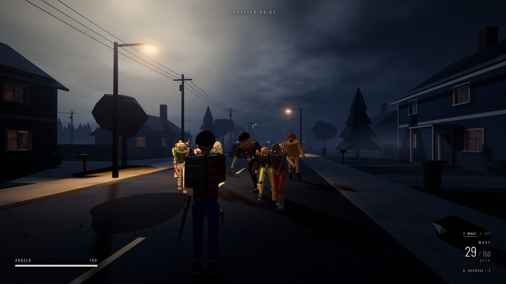

Hold out through the night in Maple Hollow, alone or with up to three friends. Gear up in the safehouse, then survive a growing outbreak with limited ammunition, bandages and whatever the supply helicopter drops. Everything runs in the browser: no installs, no downloads, and solo needs no server.

## Screenshots

### The night

| | |
| --- | --- |
| 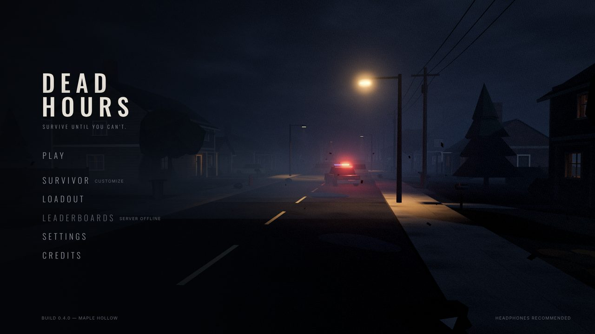 | 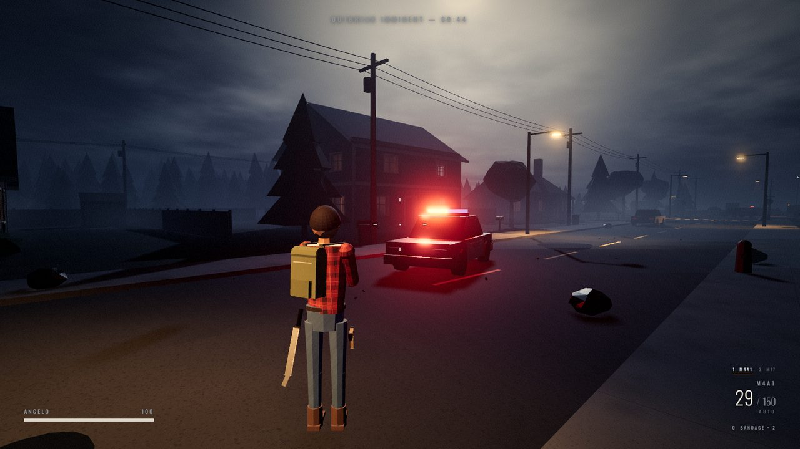 |
| Main menu, with the town behind it | Elm Street during the preparation |
| 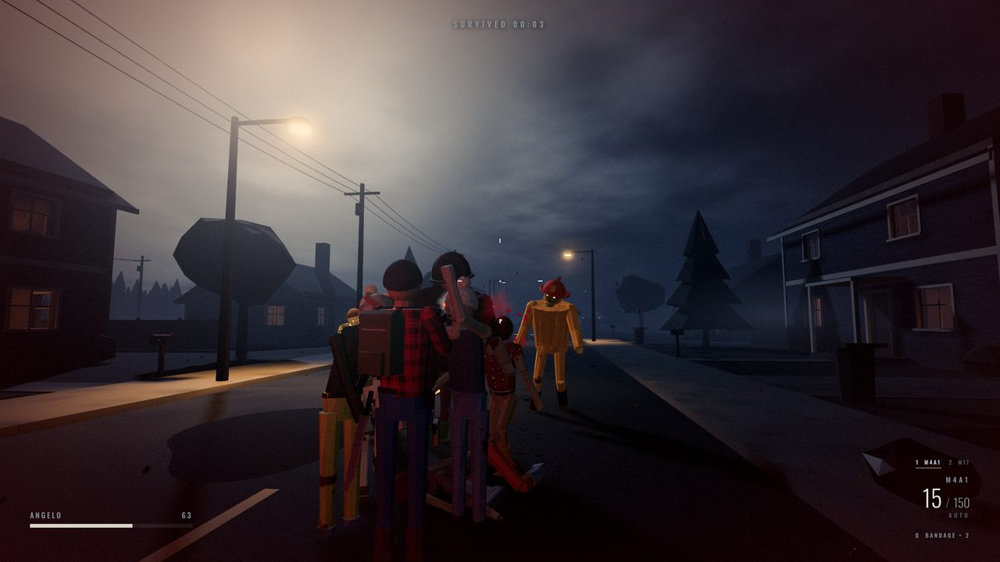 | 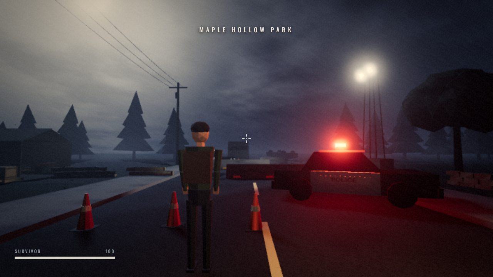 |
| Overrun at close range | The police checkpoint |

### Homes and basements

Every house on the street can be entered, and four of them have a basement, some with an ammo cache.

| | |
| --- | --- |
| 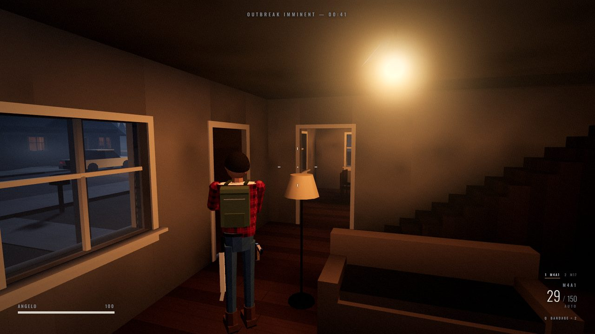 | 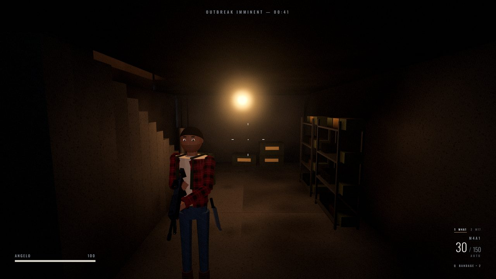 |
| The Okafor house, with stairs up and down | A basement |
| 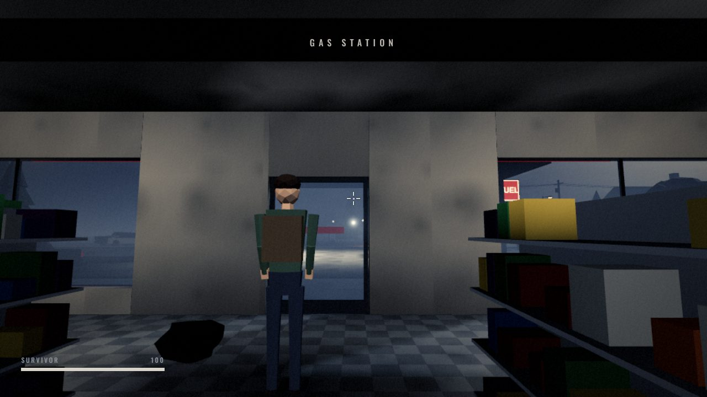 | 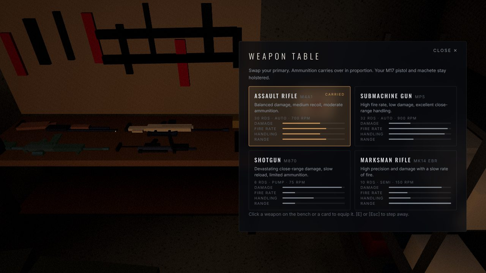 |
| The Quik-Stop store | Swapping the primary at the garage weapon table |

### Aim down the sights

| | | |
| --- | --- | --- |
| 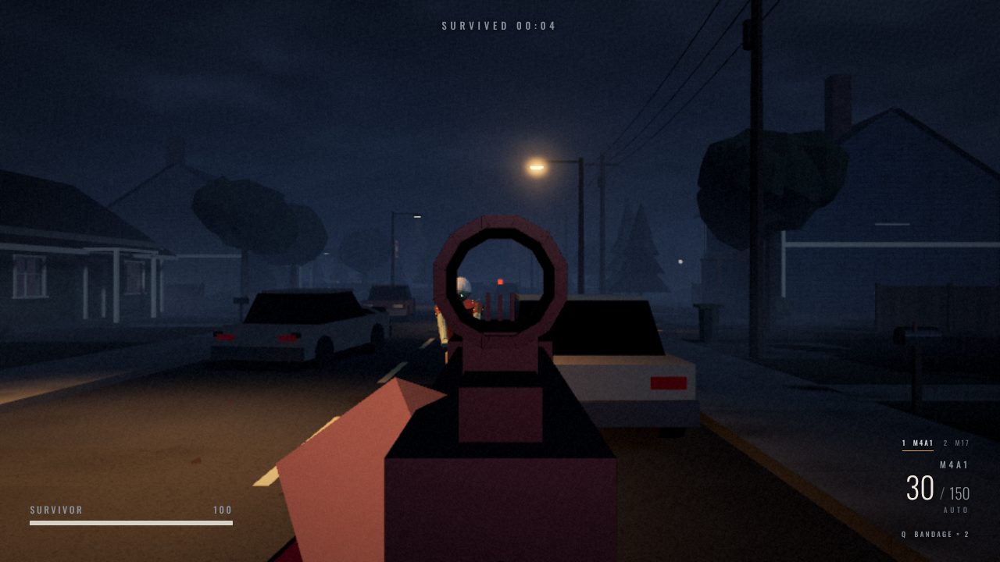 | 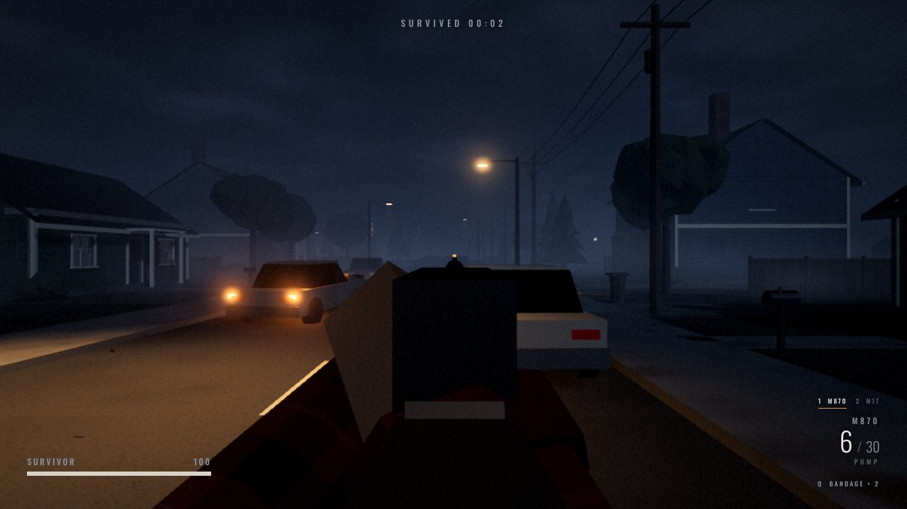 | 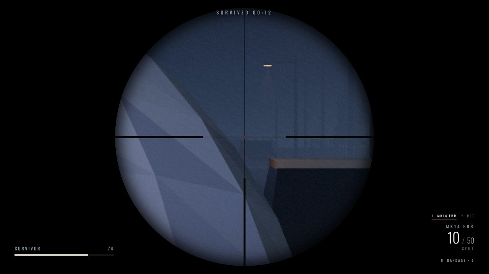 |
| M4A1 red dot | M870 bead | MK14 scope |

### Make your survivor

| | |
| --- | --- |
| 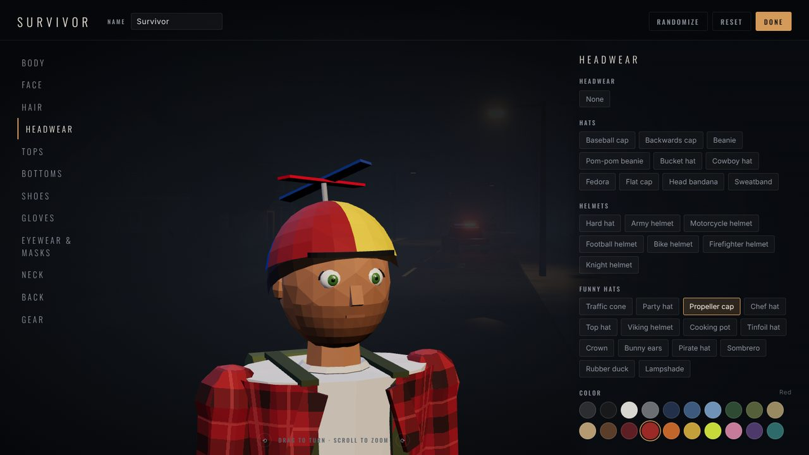 | 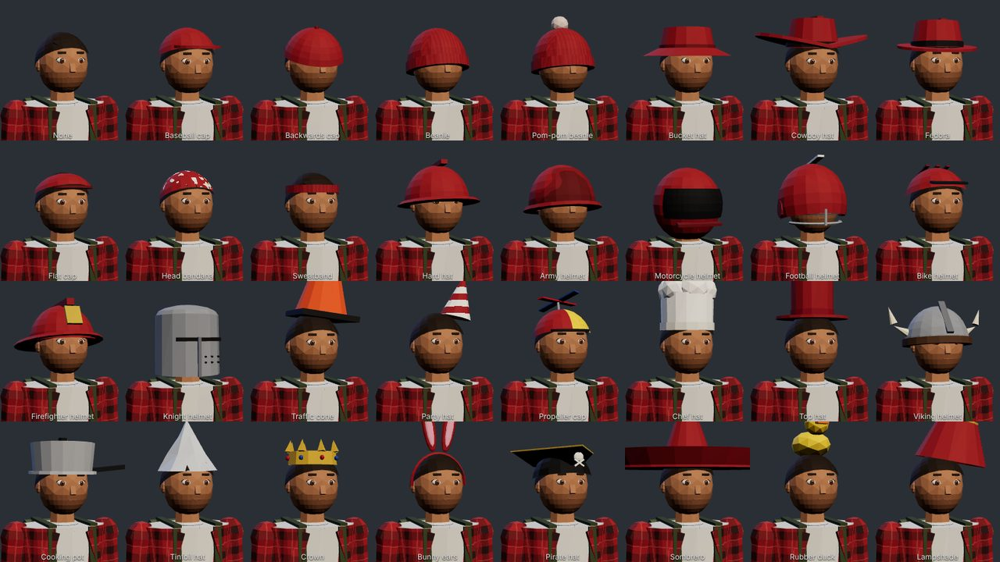 |
| The character creator, twelve tabs on a turntable | 31 hats, helmets and funny hats |
| 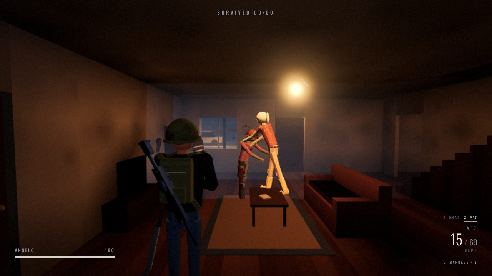 | 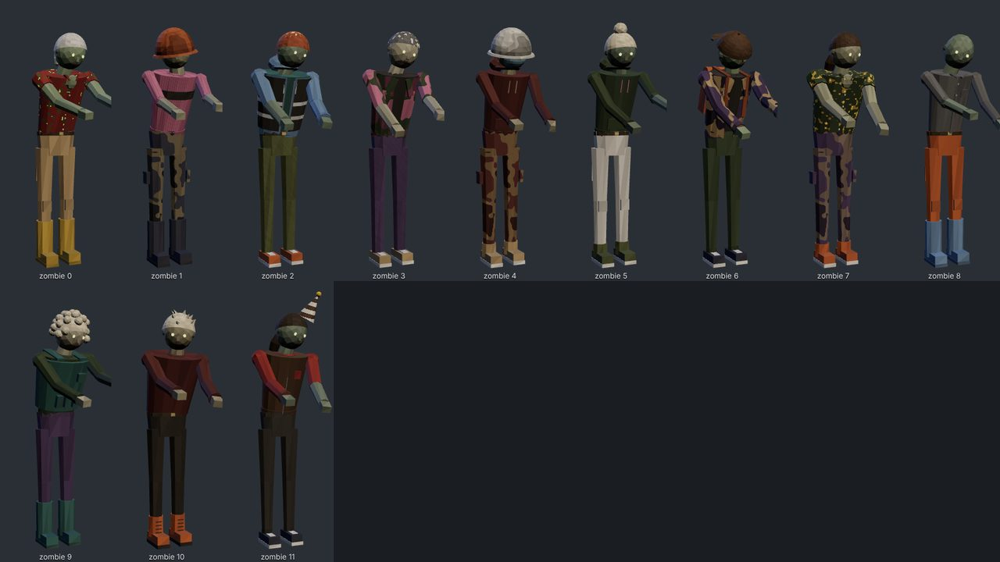 |
| Your survivor in the night | Zombies wear the same clothes, muddied |

### Play together

| | |
| --- | --- |
| 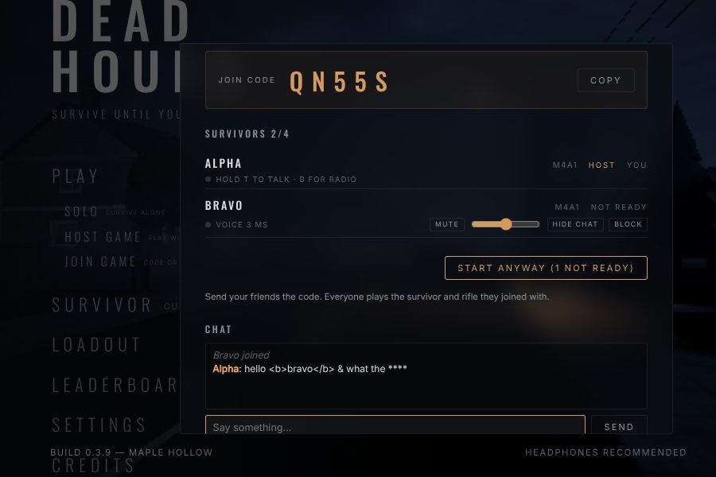 | 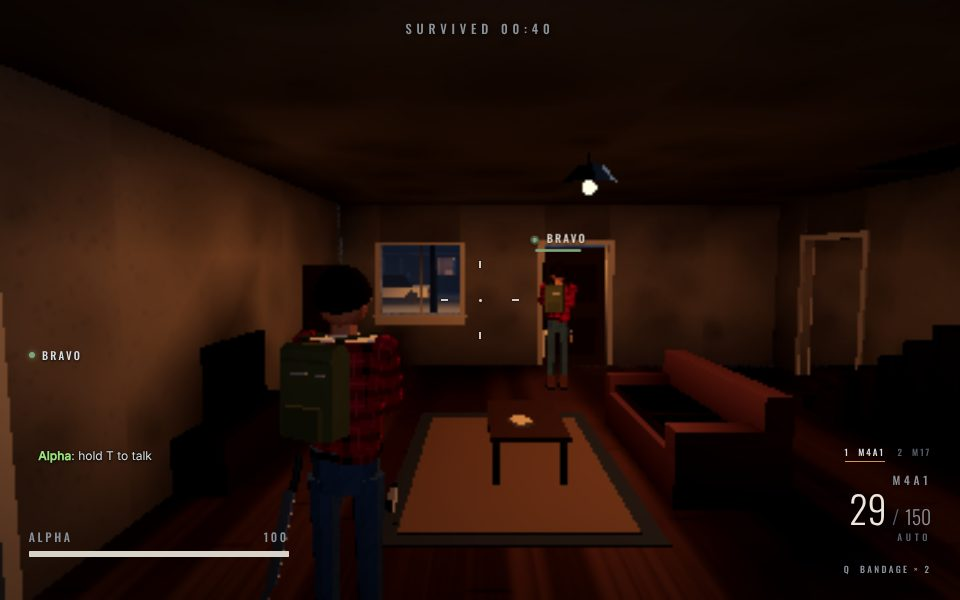 |
| Host a room and share the five-letter code | Proximity voice, team radio and text chat |

## Running

```bash
npm install
npm run dev          # client on http://localhost:5173
npm run dev:server   # game server on http://localhost:2567 (restarts on changes)
npm start            # game server, as deployed
npm run typecheck    # shared + client + server
npm run check:world  # walks a character through the real map collision (doors, stairs, passages)
npm run check:houses # every enterable home: rooms reachable, stairs walkable, basements connected
npm run check:audio  # renders every synthesized gun, action and handling sound and the echo responses; checks the recorded takes and their credits, and that teammates' full-auto fire never loses a shot
npm run check:sim    # headless combat simulation: navigation, weapons, damage, zombie AI, supplies, death, appearance wire format
npm run check:server # starts a real server and plays it over WebSocket and HTTP: rooms, codes, a night, boards, profiles, chat, voice setup
npm run check:cluster # the game cap, then two servers sharing Redis behind a balancer (needs redis-server for that part)
npm run load -w server  # bot lobbies against real server processes; prints server CPU per lobby count (SERVERS=3 for several)
npm run bench -w server # one game's server work without the network, split into physics and simulation
npm run build        # production client build into client/dist
```

In development the client finds the server on port 2567 of the same host. A production build needs `VITE_SERVER_URL` (see Online play); without it the online menu items stay disabled and say SERVER OFFLINE, and solo play works as before.

## Layout

```
shared/   map data, weapons, player tuning, network protocol, combat simulation (used by client and server)
  src/config       weapons, zombies, player tuning, survivor appearance catalog (appearance.ts)
  src/map          Maple Hollow layout, map builder (houses, stairs, walls with openings), prop colliders
  src/sim          authoritative simulation: arsenal, hit zones, zombie AI, navigation grid, events
  src/protocol     room messages, compact snapshots and the client's mirror of the server's simulation
client/   Vite + Three.js game
  src/core         engine loop, input + rebinding, settings, Rapier physics
  src/rendering    post-processing, materials, procedural textures, static batching
  src/lighting     moonlight rig, lightning, light baker (ray tracer, light field, probes, auto exposure)
  src/environment  neighborhood builder, houses, sky, atmosphere; props/ holds the procedural prop kit
  src/characters   skinned low-poly humanoid (procedural animation, two-bone IK, wounds, eyes) and ragdolls;
                   Outfit.ts builds faces, hair, clothes and accessories, CharacterPreview.ts is the dressing room
  src/weapons      weapon models, hand poses, reload/melee/bandage animation, recoil
  src/effects      particles, decals (holes, blood), shell casings, muzzle light
  src/zombies      zombie rendering: pooled bodies, interpolation, hit reactions, corpses
  src/gameplay     player controller, shoulder camera, doors, weapon table, menu cinematic, the game session
                   (solo and online) and the other survivors online (RemoteSurvivors.ts)
  src/network      server address and health (Net.ts), the room connection (NetLink.ts), player key and saved survivor (Account.ts)
  src/audio        Web Audio engine: recorded gun and flesh-hit sounds (recorded/, CC0, see Sound credits), synthesized everything else
  src/ui           main menu, settings, loadout, HUD, pause, inventory, weapon table, results,
                   online menu (host, join, lobby) and leaderboards
  tests/           headless world and audio checks (npm run check:world, check:audio)
  dev/lineup.html  dev-only page that renders survivors side by side for checking outfits (not in the build)
server/   Colyseus server
  src/game         the world's collision and navigation (built once), a night of play (Night.ts)
  src/rooms        SurvivalRoom: lobby, host, start, the running night, results
  src/net          HTTP API (health, open games, join codes, leaderboards, profiles, solo runs), input cleaning
  src/store.ts     profiles, runs, boards and accounts in Postgres (DATABASE_URL) or a JSON file
  src/net/auth.ts  Google and Discord sign-in, sessions, whose profile a request plays as
  tests/           end-to-end server check (npm run check:server)
assets/   reserved for models, textures, audio, lightmaps
```

The map is authored as data in `shared/src/map/maple-hollow.ts`. The client builds both visuals and Rapier collision from it (`propColliders` in `shared/src/map/colliders.ts` gives every prop its boxes), and the server builds identical collision from the same source.

## Lighting

Static lighting is baked in the browser on first load and cached in IndexedDB (about 3 seconds on a laptop, instant afterwards). A small BVH ray tracer over the map's boxes computes, per vertex and for a 512² ground lightmap:

- ambient occlusion (cosine-weighted hemisphere rays),
- direct light from every static lamp with ray-traced shadows (same falloff as Three.js physical lights),
- one bounce of indirect light, gathered from virtual point lights scattered off the first hits.

The bake is injected into the standard materials' irradiance, so realtime lights (moon with shadows, the flickering streetlight, police strobes, the muzzle flash later) still shade on top. Characters and door leaves are lit by light probes sampled from the same light field, and exposure adapts between indoors and out. Baked light has no highlights of its own, so puddles get the nearest unoccluded static lamps as mirror-like reflections (`patchPuddle` in `client/src/lighting/BakeShader.ts`); the night-sky environment map holds only the sky and the moon, never stand-in lamp glints. Bump `BAKE_VERSION` in `client/src/lighting/LightBaker.ts` when the baker changes; map edits invalidate the cache automatically.

### Fog, rain and post-processing

- **Volumetric fog** (`client/src/rendering/SceneFX.ts`): each pixel's view ray is marched through height fog with drifting 3D noise at half resolution (High) or a third (Medium), gathering light from the 12 (or 8) brightest lamps near the camera, plus up to 4 live lights in slots of their own, with spot cones and forward scattering. A lamp keeps its slot until a rival is clearly brighter and fades in and out over 0.6 s, so running or skating never makes a lamp's glow blink (the wet-street reflections pick their lamps the same way), and a muzzle flash never pushes a lamp out. That gives real light shafts under streetlamps, from the flashlight, the helicopter searchlight, flares, muzzle flashes and fires. Baked lamps are each confined to the box of walls around them (`client/src/lighting/FogLights.ts`), so a room lamp never glows through into the street, and the air under a roof is clearer than outside. Live point and spot lights are found by a scene scan twice a second, so new light sources need no registration (`userData.fogScale` tunes one, `userData.noFog` leaves it out). Low fog keeps the flat fog and the cheap cone meshes.
- **Lamp heads from afar** (`client/src/environment/LampGlare.ts`): a streetlight's lens is a thin disc facing down, thinner than a pixel past ~30 m, so on its own it would blink from frame to frame while the camera moves. As it shrinks below a few pixels the lens hands its light to a soft glare of the same total brightness that never gets smaller than about three pixels, which bloom can't turn into a flicker. Fog wisps fade out before they wrap around the survivor, so none pops into the street ahead.
- **Rain** (`client/src/environment/Rain.ts`, `Weather.ts`): GPU streaks that wrap in a box around the camera, stop under roofs (a top-down cover map built from the map) and catch the light of nearby lamps and the flashlight. It follows the wall clock, so everyone in an online room sees the same downpour. Exposed surfaces soak in about 20 seconds and dry over a couple of minutes (`client/src/lighting/WetShader.ts`): sky-exposed surfaces (from the baked sky visibility) darken and turn glossy, hard flat ground collects puddles with raindrop ripples, and the nearest outdoor lamps reflect in the wet street. Rain is heard by space: an open hiss outside, a roof drum indoors, a murmur in basements.
- **Post chain**: scene → SSAO (depth-only, half resolution, for contact shadows the bake can't know about) → volumetric fog → camera motion blur (from depth reprojection; the gun and hands are left sharp) → bloom → ACES → night grade (a 32³ 3D LUT, `client/src/rendering/ColorLUT.ts`) with vignette and film grain. With every effect off the scene draws straight into the composer's buffer, so the Phone preset pays nothing for them.
- **Flashlight** (`client/src/gameplay/Flashlight.ts`): a small angle-head lamp clipped to the left of every survivor's chest, switched on and off with L (rebindable), a tap of D-pad up on a controller (hold it to switch shoulders) or the LIGHT button on a touch screen, with the click of a real tailcap switch. The lamp rides the body (it bobs with each step and falls with it) while its beam follows the aim, as far as a chest lamp can swing (about 57° from straight ahead; it never shines back through the survivor). The light sits a hand's width behind the lens, so a gun or a hand right in front of it is lit, not burnt white, and the survivor's own gun and arms are kept out of its shadows. It casts shadows on Medium and High and lights the fog and the rain; the HUD shows whether it is on. Online the switch rides in each survivor's motion flags: teammates' lamps light the world too (the nearest three, one on phones, without shadows), glow and glare when pointed at you, and click when flipped nearby. Every light sits in the scene from boot at zero intensity, since adding a light later would recompile every material.
- Settings → Graphics: Ambient occlusion, Motion blur and Rain toggles; Fog quality Medium/High turns on volumetrics. Presets: Phone (flat fog, no AO or blur, rain off by default: with rain off the wet shading is compiled out), Low (flat fog, light rain with a cheap wet look), Medium (third-resolution volumetrics, AO), High (half-resolution volumetrics, AO, motion blur, MSAA).

## Combat

Solo play runs the same authoritative simulation the game server runs online (`shared/src/sim`). The client only sends intents (fire along the camera ray, reload, switch, melee, bandage, use) and renders the events that come back, so damage, ammunition and health never live in the client.

- Weapons: M4A1 assault rifle, MP5 submachine gun, M870 pump shotgun (shell-by-shell reload, interruptible), MK14 marksman rifle (penetrates one body), M17 pistol, machete. Pick the starting primary in Loadout, swap it at the garage weapon table.
- Ammunition is limited. Ammo crates refill reserves twice each; first aid boxes hold bandages (Q, 2.6 s, +40 HP, interrupted by damage).
- Zombies have head, torso, arm and leg hit zones (head ×2.5). They hear gunfire and footsteps, spot you in their sight cone (crouching shortens it), path through houses, pound and break doors, stagger and get knocked down.
- 45 seconds of preparation, then the outbreak: a growing population of walkers and no waves. Death ends a solo run with the results screen.
- Gore can be set to Off, Reduced or Full in Settings → Graphics.
- Gun shots are real recordings (`client/src/audio/recorded`, CC0 from Freesound, see Sound credits), four takes per gun picked at random with slight pitch variation: the M17 and MP5 from a 9 mm pistol at an outdoor range (the MP5's takes shorter and barkier), the M4A1 and M249 from an AR-15 (5.56, the M249 a touch lower), the MK14 from a .303 Lee-Enfield (no clean, freely licensed 7.62 NATO recording was found; it is the nearest full-power rifle), the SCAR-H from a SCAR-H, the M870 from a 12 gauge fired four times, the M107 from a Barrett .50 in an open field and a .50 BMG at a range. They are Freesound's high-quality previews, not the original files (those need a login). `client/dev/make_recorded_sounds.py` rebuilds them: it finds each shot, cuts and pitches the takes, adds body and bark with EQ, limits, and checks they decode under full scale. Your own shot adds a sub-bass kick and pushes the rest of the mix down for a moment. Guns play on their own bus, louder than other effects and following the Effects volume, with no compressor on it (one flattened each crack by 15 dB); a soft clipper on the output rounds off anything over the top. Until the recordings are decoded, or if they fail to, the synthesized shots from `client/src/audio/GunSynth.ts` play (muzzle blast, gas jet, supersonic crack, steel ring); the action under each shot and the dry fire are still synthesized.
- Reloads are real recordings too (the Free Firearm Sound Library, see Sound credits), placed on each gun's hand animation (`client/src/weapons/reloadScript.ts`): the M4A1's release clicks and the magazine scrapes out as the hand takes it, goes into the pouch, a fresh one comes out and seats with a hard click as the hand pushes it home. A reload from empty also sends the bolt home (the bolt catch on the M4A1 and SCAR-H, the op rod on the MK14, the charging handle on the M107 and M249, the slide stop on the M17); with a round still chambered it doesn't. The MP5 locks its bolt back before the magazine comes out and slaps it home after; the M249 opens its feed cover, swaps the box, lays the belt and slams the cover; the M17's magazine drops free and clatters at your feet; the M870 thumbs each shell into the tube as the hand reaches the port and racks the pump after loading an empty tube. Each take leads up to its main hit and the engine lines that hit up with the hand. Other survivors' reloads come from their hands, carry about 30 m, are muffled through walls, and ring in the room they are in, like your own.
- Hits on zombies are heard, not beeped: the hit marker is visual only, and every round going into a body plays a recorded flesh impact with a wet layer, a skull hit on headshots and a heavy punch under big or melee hits, from where it landed (late by distance, muffled through walls). Your own hits carry farther than other people's; a load of buckshot lands as one hit.
- Zombies carry farther than other sounds (full level to 6 m, then fading slowly, so a groan is still heard at 60 m) and are muffled through walls. Their footsteps are heard to 45 m: walkers plant a heel and drag the other foot, runners slap the ground fast, brutes stomp; floorboards sound hollow, a basement hard. Distant steps share a budget so a horde doesn't turn into noise.
- Where a shot is heard decides how it sounds (`client/src/audio/Acoustics.ts`). Raycasts against the map sort each spot into street, room, hall (garages and the store, by their concrete floors) or basement, and each space has its own echo: on the street the facades slap a shot back one by one for about two seconds, a living room rings short and dull (0.8 s), a garage or the store longer (1.1 s), the concrete basement booms (1.5 s). A shot fired indoors also leaks, muffled, into the street echo, and a street shot leaks into the room you are in.
- Every shot that is not your own plays from where it was fired with 3D (HRTF) panning, late by its distance at 343 m/s and with less of its direct sound the farther it is. Walls between you and the gun muffle it by what they are made of (glass a little, wood and plaster a lot, brick and concrete almost entirely; `Physics.crossings` lists every surface on the line). A supersonic round passing within 10 m cracks from the point where it passed you, ahead of the report: loud for the M4A1 and MK14, faint for 9 mm and buckshot, none for the M17. At most 10 shots from others play at once; a nearer one takes over from the farthest. Online, other survivors' shots go through this same path from their positions. Inside, a recorded take's own outdoor tail is cut short and the room's echo takes over.
- To hear or measure the gun sound, run `npm run dev` and open `/dev/gunclips.html`: **Render clips** plays each gun in each space, the distance, wall and fly-by cases, flesh hits, zombie steps and groans through the game's own audio graph, with a save link per clip (`renderClips({ synth: true })` from the console renders the synthesized shots instead). `python3 -I client/dev/analyze_gunclips.py CLIPDIR OUTDIR` measures saved clips (C50, ring time, spectral centroid, crack and report timing), draws spectrogram sheets and joins each gun's four spaces into one A/B file.
- To stress the sound in a four-player firefight, open `/dev/firefight.html`: **Play it live** fires three teammates on full auto and your bursts into a horde (flesh, impacts, cases, steps, groans) through the real engine and reports dropped or cut teammate shots and audio underruns (`AudioContext.playbackStats`). From the console, `firefight({ seconds: 10, wav: true })` renders it offline instead and reports the audio thread's load second by second; a load that climbs over the fight means finished sounds are not leaving the mix.
- Barricading: from inside a home, hold G at a door or ground-floor window to nail boards across it (4 on a door, 3 on a window, 1.5 s each; the hammering carries to zombie ears). Hold E to pry one off. A boarded door won't open. Zombies beat the boards off one at a time, smash window glass and climb in through empty windows; doors still get pounded until they burst. Bullets shatter panes and fly on into the room, and shots into a closed door splinter its boards, then knock it in. Everything is decided by the simulation and synced to every player online.
- Aiming looks down the sights in first person: the camera moves into the survivor's eye and the weapon's sights line up with it. Out of the box the M4A1 has iron sights, the MP5 a peep sight and hooded post, the M870 a fiber-optic bead, the M17 three-dot night sights and the MK14 a 6× scope (zoomed view with a duplex reticle); fitted optics replace them (see Progression). Settings → Controls → Aim view switches back to the over-the-shoulder zoom.
- Skateboards (`shared/src/sim/Skateboards.ts`, `client/src/gameplay/Skateboards.ts`): six boards lie on the streets, sidewalks and driveways each night (one a short walk from the safehouse, the rest spread out, some flipped wheels-up), in the same spots for everyone in a room. Walk up and press E (RB on a controller, USE on a touch screen) to hop on and again to step off. Forward pushes (Shift pushes harder: about 10 m/s after two seconds and up to 12.5, against 6 on foot; the view widens with speed), A/D carve, back brakes, Space ollies. Grass and dirt grab the wheels. Shooting and aiming work as usual while rolling (spread grows a little less with speed than on foot), and the camera swings in behind the board unless you look around. The wheels grind over asphalt, hiss on smooth concrete and clack over every sidewalk seam; kicks, ollie pops, landings, hopping on and off and bails all have their own sounds, from your board and everyone else's (synthesized in `AudioEngine`; render them with `/dev/skateclips.html` beside a survivor's running steps). Zombies hear the wheels at a few metres; a hard hit or running into a wall fast throws you off. Online, each rider's browser moves the board like it moves their feet: the heading rides in the motion message, the server lets riders go faster than runners, and snapshots carry who is on which board. Check with `npm run check:skate`.

## Progression

Every night earns XP (`shared/src/config/progression.ts`): time survived, kills, headshots, arms torn off, arm kills and supplies found. Levels run 1 to 50 and each one opens attachments and finishes for the guns you can start with (not the machete or the supply-drop guns).

- Optics (red dot, holographic, 3× prism, 6× scope), muzzle devices (suppressor, compensator, full choke), underbarrel (vertical grip, angled grip, laser), magazines (extended, fast) and eleven finishes. Each attachment changes the gun's numbers both ways, for example a suppressor cuts the noise zombies hear by 60% but costs damage and range. Finishes are cosmetic.
- Main menu → **Loadout** is the armory: a 3D gun on a turntable with clickable fitting labels, the options for each slot (locked ones say the level they open at), what each change does, and the unlock track.
- In a night, press **H** anywhere to hold the gun up and change fittings on the fly (you stand still, the night goes on and a hit puts it away), or use **Gunsmith** at the safehouse weapon table. A refit takes 1.2 s with the gun down.
- Online the server owns XP and unlocks: it scores each night, keeps XP on the saved profile (and on the signed-in account) and refuses any fitting the profile hasn't unlocked. Solo XP is saved through the same profile when the game server is reachable, else kept in the browser.
- Supporter finishes (carbon, neon, hazard) are tied to a `supporter` entitlement on the profile, ready for the Supporter Pack. Option lists are append-only: their indices are the wire format of a build.

## Survivors

Main menu → **Survivor** opens the character creator: a lit turntable preview (drag to turn, scroll to zoom, the camera frames the part you are editing) and twelve tabs.

- Body: 10 skin tones, slim / average / broad build. Face: 6 eye shapes (round, almond, wide, narrow, sleepy, fierce), 10 eye colors, 7 facial hair styles. Hair: 14 styles, 16 colors.
- Headwear: 31 pieces in three groups. Hats (caps, beanies, bucket, cowboy, fedora, flat cap, bandana, sweatband), helmets (hard hat, army, motorcycle, football, bike, firefighter, knight) and funny hats (traffic cone, party hat, propeller cap, chef hat, top hat, viking, cooking pot, tinfoil, crown, bunny ears, pirate, sombrero, rubber duck, lampshade).
- Tops: 18, from T-shirts, tank tops, button-ups, striped, Hawaiian and flannel shirts (buttoned or open over a tee) to sweaters, hoodies and denim, leather, varsity, track, puffer, rain and camo jackets. Fabrics are drawn in the shader (plaid, stripes, camo, floral, knit, denim) with a separate accent color.
- Bottoms (7), shoes (5), gloves (4), eyewear and masks (11), neck pieces (6), back items (backpack, hiking pack, messenger bag, katana, guitar) and gear (tactical and hi-vis vests, bandolier, utility belt, fanny pack, knee pads), each with a color from a 20-color cloth palette.
- Randomize, Reset and the survivor name live in the creator header. Choices save with the profile and the slung weapon sits on top of whatever is on your back.

The look is plain data (`shared/src/config/appearance.ts`): catalog ids plus palette indices, sent as a short versioned string (`"1.4.1.2…"`) in the join options. The simulation stores the sanitized string per player and the server sends it to everyone in the room, so other players see your survivor. Catalogs and palettes are append-only: never reorder or remove entries, because indices are the wire format. Zombies are dressed from the same catalog, with muddied clothes and glowing eyes.

## Online play

Main menu → Play → **Host game** makes a room on the game server: give it a name, make it public (listed under Join game) or private (code only), and send friends the five-character code. **Join game** lists the open public rooms and takes a code. In the room's lobby everyone marks ready and the host starts the night; up to four survivors.

- The server runs the night: the same simulation as solo, with zombies, damage, ammunition, doors and supply drops decided there. Survivors, shots and damage run at 60 steps a second; zombies and the collision world move every third step (20 a second, with each snapshot), which keeps a busy night near a tenth of a CPU core (see Running many games). It sends a compact snapshot 20 times a second and every event as it happens. Each client draws the others smoothed between snapshots and shows its own shots, reloads and swings at once.
- Hosting means creating the room and starting its nights; the room lives on the game server, not on the host's machine, so the night carries on if the host leaves (the next player who joined becomes host). This is not peer-to-peer.
- The server checks each survivor's movement (speed, climbing, walls, map bounds) and puts them back when it doesn't add up.
- When you die you can watch the others; when everyone is dead, everyone gets the team results and goes back to the lobby together.
- A room is locked while its night is playing, so friends join between nights.
- A connection that drops mid-night reconnects by itself: the server holds the survivor's place for 20 seconds (they stand still meanwhile) and the game shows CONNECTION LOST · RECONNECTING until it is back. After that it returns to the menu.
- The server streams a night to each player only once their scene is built, and allows a few seconds of stalls (a slow machine, a hitch) before it counts a connection as lost.

**Survivors and stats.** Each browser makes a player key (kept in local storage). The survivor's name, look and primary weapon are saved under it on the server whenever they change, along with lifetime stats: runs, kills, headshots, arms torn off, time survived, best time and most kills. Main menu → Leaderboards → Your survivor shows the key; entering it on another device brings the same survivor and stats there.

**Accounts.** Main menu → Account signs in with Google or Discord (whichever the server has keys for). Guests keep playing exactly as before; signing in ties the survivor, stats, places (and unlocks) to the account instead of the browser key, so every device signed in plays as the same survivor.

- Signing in folds the browser's guest profile into the account: the first time it simply becomes the account's survivor; later ones add their totals and keep the better bests, and the account's look stays. A Google and a Discord login with the same verified email are the same account.
- The sign-in runs in a popup (the whole page goes there and back when popups are blocked). The server does the OAuth code exchange itself, so the client never sees the service's tokens; it hands the game a one-time code (a minute, single use, bound to a nonce the game made) that `POST /api/auth/exchange` trades for a session. Sessions last 180 days, are stored hashed, and are sent as `Authorization: Bearer`. Sign-ins only ever return to an address in `CLIENT_ORIGINS`.
- Boards mark signed-in players with ✓. Online rooms count a signed-in player's runs for their account.
- Routes: `GET /auth/{google,discord}/start?return&nonce`, `GET /auth/{provider}/callback`, `GET /api/auth/providers`, `POST /api/auth/exchange`, `POST /api/auth/logout`, `GET /api/me`.

**Voice and text chat.**

- Voice goes straight between the players' browsers (WebRTC); the game server only passes the connection setup along and never hears it. Opus, mono, up to 40 kb/s, with in-band error correction and silence suppression, and the browser's echo cancellation, noise suppression and auto gain (each can be turned off in Settings → Voice).
- Push to talk (hold T) by default, or voice activation with an activation level. Settings → Voice has the microphone list, a mic meter with TEST MIC, the keys, and a list of blocked players.
- In play each voice comes from that survivor's mouth in 3D, gets quieter with distance, fades out between 35 and 50 m and is muffled through walls. Hold B for the team radio: everyone hears it at full level through a narrow radio sound with a squelch, and a survivor who has fallen is heard over it whenever they talk (Settings → Voice → Hear team radio turns it off). In the lobby everyone is heard plainly.
- Speaking lights show in the lobby list, over name tags and in a list at the left of the screen. Each player can be muted, turned down or up (0 to 200 %), have their chat hidden, or be blocked, from the lobby or Esc → Players. These choices stay in the browser by the player's lasting id. Blocking is also enforced by the server: no chat or voice either way.
- Text chat works in the lobby and in play (Enter opens it, Enter sends, Esc closes). The server cleans every line (control, direction and invisible characters, stacked accents), cuts it to 160 characters, allows a burst of 4 lines and then one every 1.5 s, drops a repeat sent within 4 s, and stars out a word list (including spaced-out and number-for-letter spellings). Lines are put on the page as text, never as HTML.
- Players behind strict networks (some offices, schools, mobile carriers) can only connect through a TURN relay: set `TURN_URLS` (see Deploying). Settings → Voice → Relay only sends all voice through it, which also hides a player's address from the others.

**Leaderboards.** Longest survival and most kills, one entry per player (their best run). Online runs are recorded by the server. Solo runs are reported by the browser at the end and marked SOLO: the server refuses ones that can't be right (more kills than the time allows, more hits than shots) and limits how often a key can post, but it cannot replay a solo run, so treat those as honest-player scores.

### Deploying

The client is a static site (`npm run build`, publish `client/dist`). The server is a Node process (`npm start`); several can share the games (see Running many games).

| Variable | Where | What |
| --- | --- | --- |
| `VITE_SERVER_URL` | client build | The server's address, `https://…` or `wss://…` (both work). |
| `PORT` | server | Port to listen on (default 2567). |
| `DATABASE_URL` | server | Postgres connection string. Tables are created on start. TLS is used for remote hosts unless `sslmode` or `PGSSLMODE` says otherwise. |
| `DATA_FILE` | server | Without `DATABASE_URL`: the JSON file for profiles and boards (default `server/data/dead-hours.json`). |
| `STUN_URLS` | server | Comma-separated STUN servers given to browsers for voice. Unset: Google's public `stun:stun.l.google.com:19302`. Set empty: none. |
| `TURN_URLS` | server | Comma-separated TURN relays for voice, e.g. `turn:turn.example.com:3478,turns:turn.example.com:5349?transport=tcp`. Needs one of the two logins below. |
| `TURN_SECRET` | server | coturn's `static-auth-secret` (`use-auth-secret`): each player gets their own TURN login that expires after 24 hours. |
| `TURN_USERNAME`, `TURN_CREDENTIAL` | server | A fixed TURN login instead of `TURN_SECRET`. |
| `REDIS_URL` | server | Redis (Render Key Value) shared by several server instances, `redis://…` or `rediss://…`. Unset: one process on its own. |
| `MAX_ROOMS` | server | Games one server process runs before new ones go to another or are refused (default 8). |
| `SELF_HOSTNAME` | server | With `REDIS_URL`: this instance's private address, only if it can't find it itself. |
| `AUTH_GOOGLE_ID`, `AUTH_GOOGLE_SECRET` | server | Google sign-in (an OAuth client of type Web application). Redirect URI: `<server address>/auth/google/callback`. |
| `AUTH_DISCORD_ID`, `AUTH_DISCORD_SECRET` | server | Discord sign-in (an application's OAuth2 client id and secret). Redirect: `<server address>/auth/discord/callback`. |
| `CLIENT_ORIGINS` | server | Comma-separated addresses the game is played from, e.g. `https://play.example.com,https://deadhours.pages.dev`. Sign-ins return only to these (localhost works when it is unset). |
| `AUTH_SECRET` | server | A long random string that signs sign-in state. Needed with several instances; one process makes its own on start. |
| `PUBLIC_URL` | server | The server's public `https://` address for the redirect URIs. When unset: Railway's `RAILWAY_PUBLIC_DOMAIN`, Render's `RENDER_EXTERNAL_URL`, else the request's forwarded host. Set it when the server has its own domain. |
| `DEAD_HOURS_DEBUG` | server | `1` enables test commands in rooms (skip preparation, spawn zombies, hurt, full health). Never in production. |

Accounts need a store (Postgres, or the data file on a single server). Sign-in is off until a provider's id and secret are set; the menu then says sign-in isn't available and guests play as before.

`GET /health` answers `{ ok, version, store, games, maxGames, forwarded }` (the last three for this process). The server logs one line per room event (opened, joined, left, lost connection, reconnected, night started, night over with each survivor's time and kills). The HTTP API sends CORS headers for any origin, and Colyseus answers `/matchmake` with its own. Messages to the game server are capped at 16 kB (voice setup needs a few kB). A TURN relay needs open UDP ports, which web app hosts such as Render don't offer: run coturn on a small VPS or use a managed TURN service, and keep the secret out of the client. The server builds the map's navigation once at start (about two seconds) and each room builds its own physics.

### Running many games

A busy game (four survivors, two dozen zombies) takes about a tenth of one CPU core on the server, and a game waiting in its lobby next to nothing. Measured with `npm run load -w server` (bots playing real nights, four to a game, each with 24 extra zombies) on a 4-core machine:

| Games | Server processes | Server CPU | Snapshots per player per second (20 is full rate) |
| --- | --- | --- | --- |
| 3 | 1, version 0.3.9 | 104 % of a core | 18.8 |
| 5 | 1 | 47 % | 20 |
| 10 | 1 | 91 % | 18.4 |
| 15 | 1 | 103 % (out of CPU) | 7.5 |
| 25 | 3 | 256 % (85 + 78 + 92) | 19.3 |

- One process runs all its games on one core, so a second CPU on the same instance goes unused: pick 1-CPU instances and add more of them rather than bigger ones.
- `MAX_ROOMS` (default 8) caps the games in one process, so a full process still has CPU to spare for its busiest nights. A new game goes to the process running the fewest; when every process is at its cap, Host game shows SERVERS ARE FULL with Try again, Join a game and Play solo. Players can still join the games that exist.
- Several instances: give the service `REDIS_URL` (a Render Key Value in the same region, its internal URL) and `DATABASE_URL` (a data file isn't shared between instances), then raise the instance count. Each game lives on one instance; Redis shares matchmaking, the game list, join codes and each instance's game count. Render's load balancer hands each connection to any instance, so one for a game elsewhere is passed through to that instance over the private network. Each instance finds its private address through `RENDER_DISCOVERY_SERVICE` (or `SELF_HOSTNAME`). This needs paid instances (free ones can't receive private traffic) and no persistent disk on the service (a service with one can't run several instances).
- Without `REDIS_URL` the server runs on its own as before.
- A deploy or a stopped instance ends the games on it, as with one server; games on the other instances carry on.
- `GET /health` gives `games`, `maxGames` and `forwarded` (connections passed to another instance) for the instance that answered.

## Sound credits

All recordings are CC0 (public domain dedication) from [Freesound](https://freesound.org); credit is not required but given. The game uses the high-quality previews, cut and processed by `client/dev/make_recorded_sounds.py`.

| Used for | Recording | Author |
| --- | --- | --- |
| M17, MP5 | [9mm Pistol Gunshots](https://freesound.org/s/731942/) | DledeSOUND |
| M4A1, M249 | [AR15 pistol shot](https://freesound.org/s/427598/) | michorvath |
| MK14 | [gun lee enfield 303 rifle clean shot](https://freesound.org/s/450853/) | kyles |
| M870 | [Shot Gun - 12 Gauge- Fire Four Shots Quickly](https://freesound.org/s/619041/) | mrrap4food |
| SCAR-H | [FN SCAR-H](https://freesound.org/s/702225/) | areniporgen |
| M107 | [50CaliberOnePigRoast2012](https://freesound.org/s/169170/) | kvgarlic |
| M107 | [50 cal shot](https://freesound.org/s/668071/) | ajhartman42295 |
| Flesh hits | [VisceralBulletImpacts](https://freesound.org/s/423301/) | u1769092 |
| Flesh hits (wet) | [Wet Splat 1](https://freesound.org/s/495118/) | nebulasnails |
| Flesh hits (wet) | [GROSS IMPACT](https://freesound.org/s/641040/) | magnuswaker |
| Headshots | [Headshot](https://freesound.org/s/511194/) | Pablobd |
| Heavy and melee hits | [Major punch](https://freesound.org/s/399183/) | janbezouska |
| Flashlight switch | [flashlight click](https://freesound.org/s/629008/) | realgtro |

Reloads (magazines out and in, bolts and slides going home, shells into the tube, the pump, the M249's feed cover) are cut from [The Free Firearm Sound Library](https://opengameart.org/content/the-free-firearm-sound-library) by Ben Jaszczak, Brian Nelson, Kevin Heras and Matthew Nanney, released CC0: its raw 192 kHz tracks, from the [GitHub mirror](https://github.com/buddingmonkey/FreeFirearmsSFXLibrary) at commit beb2f40. AR-15 for the M4A1, SCAR-H and M249; Walther PPQ for the M17; Benelli Nova and Winchester Model 12 for the M870; Carl Gustav M45, AK-47 and SKS for the MP5; AK-47, Tikka T3 and SKS for the MK14 and M107; Mosin Nagant and Arisaka hatches for the M249's cover.

## Controls

WASD move · Mouse look · Shift sprint · Ctrl or C crouch · Space jump · LMB fire · RMB aim down sights · R reload · E interact (hold to pry a board off) · G board up (hold) · F melee · H gunsmith · 1 / 2 / wheel switch weapon · Q bandage · Tab inventory (hold) · V switch shoulder · L flashlight on / off · E on a skateboard to ride it (forward pushes, Shift harder, Space ollies, E again to step off) · Esc menu (pauses solo play; online the night goes on). Online: T push to talk · B team radio · Enter chat. All bindings are editable in Settings → Controls.

## Roadmap status

- **Phase 1 Foundation**: done.
- **Phase 2 Environment**: done. Maple Hollow, 250 × 300 m: Elm Street, Birch Lane and Oak Street (the next street over: ten more enterable homes, five with basements, tee-ing into Birch and dead-ending at a trail from the park) with sidewalks, alleys and fourteen streetlights (a few dead, one flickering); ten houses (eight enterable homes, four with basements, the two-storey safehouse with kitchen, living room, three bedrooms, basement, garage and four ways in, and the enterable Henderson house); the Quik-Stop gas station with an enterable store; a park with playground and gazebo; a police checkpoint with a barrier chicane and floodlights; fenced backyards with sheds and tight side passages; woods around the edge. Baked AO, shadows and bounce light plus fog and dynamic lights.
- **Phase 3 Combat**: done. Six weapons with real models, hand IK, reload animations, recoil and holsters; muzzle flashes, tracers, shell casings and surface impacts; pooled blood, wounds, hit reactions and ragdoll deaths; zombie AI; weapon table, ammo crates and first aid; HUD with weapon panel, dynamic crosshair, hit markers, damage direction, timers and ammunition warning; inventory and results screen.
- **Character customization**: done (see Survivors).
- **Phase 4 Multiplayer**: done (see Online play). Hosted rooms with codes and a public list, the night run on the server, leaderboards and saved survivors, proximity voice with team radio, and text chat.
- Phase 5 Survival director · Phase 6 Defenses · Phase 7 Helicopter drops · Phase 8 Polish.
