# Screenshots

## The night

| | |
| --- | --- |
| 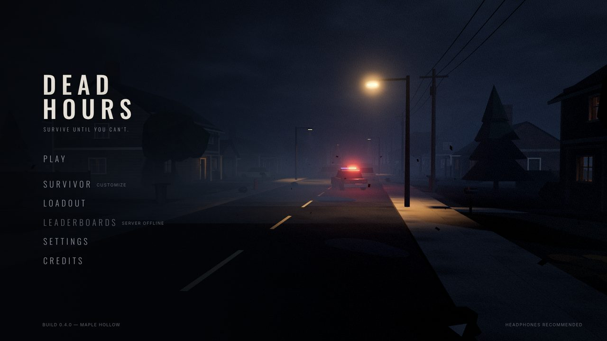 | 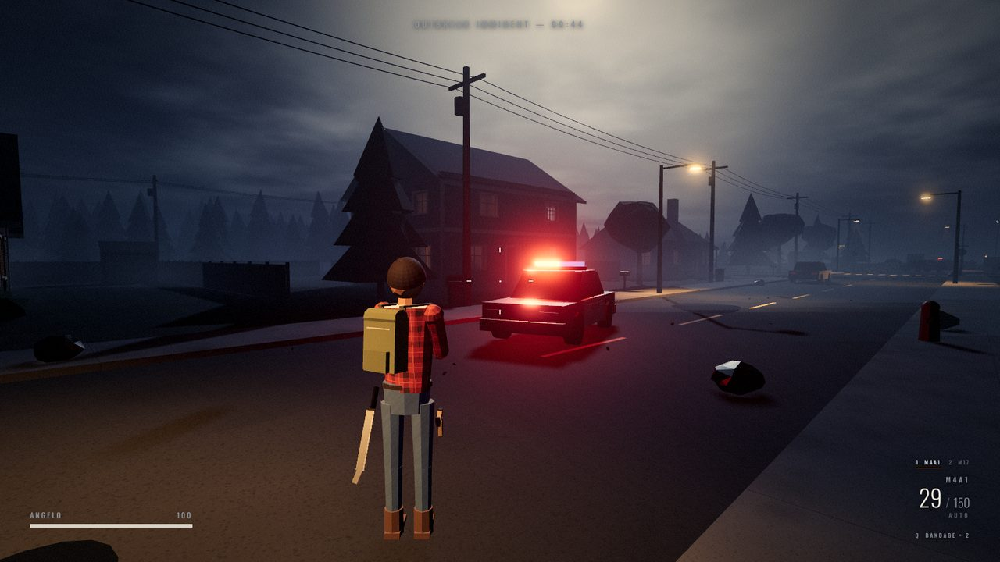 |
| Main menu, with the town behind it | Hale Street during the preparation |
| 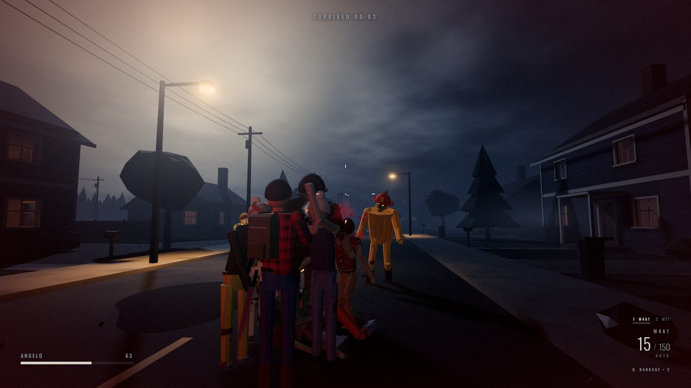 | 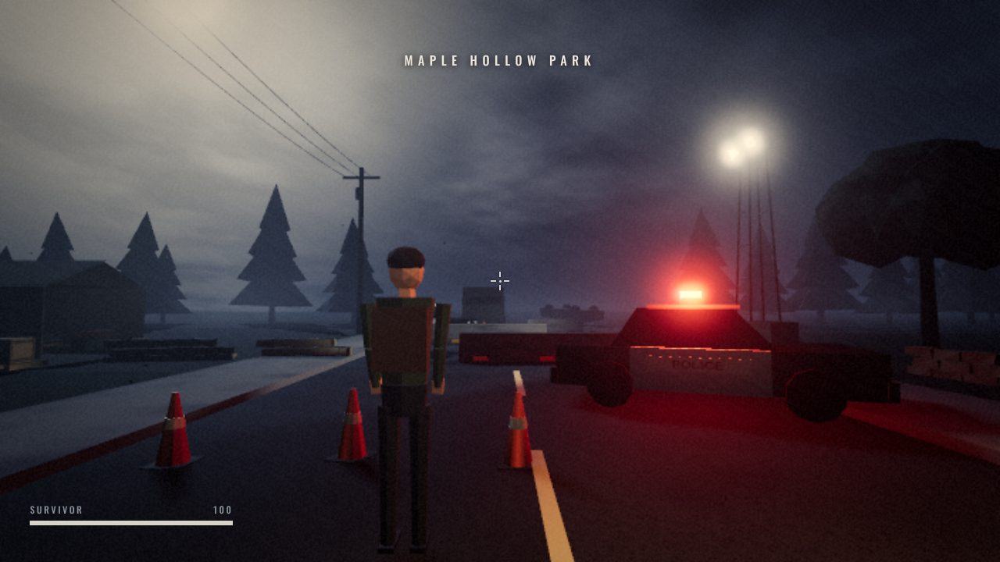 |
| Overrun at close range | The police checkpoint |

## Homes and basements

Every house on the street can be entered, and four of them have a basement, some with an ammo cache.

| | |
| --- | --- |
| 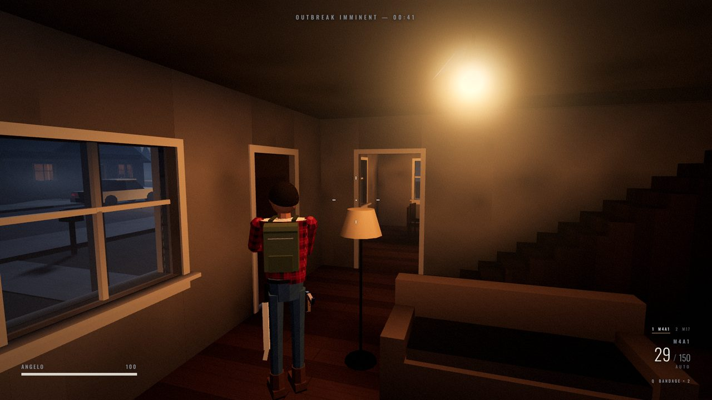 | 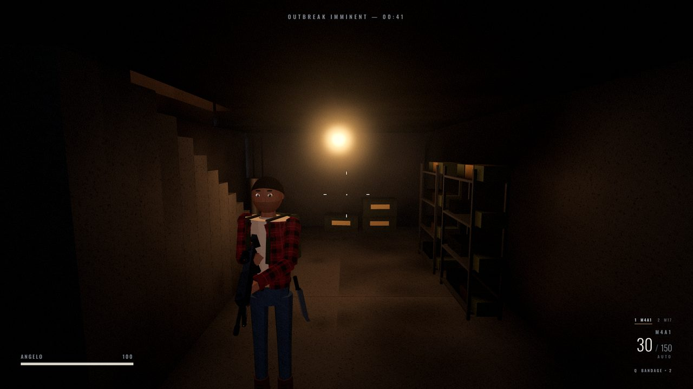 |
| The Okafor house, with stairs up and down | A basement |
| 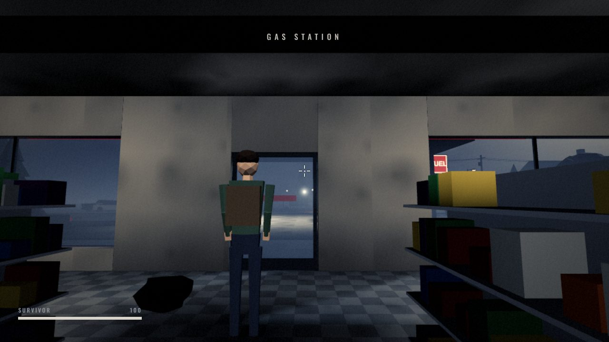 | 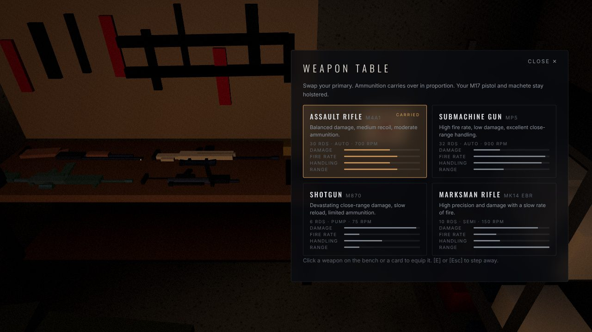 |
| The Rudy’s store | Swapping the primary at the garage weapon table |

## Aim down the sights

| | | |
| --- | --- | --- |
| 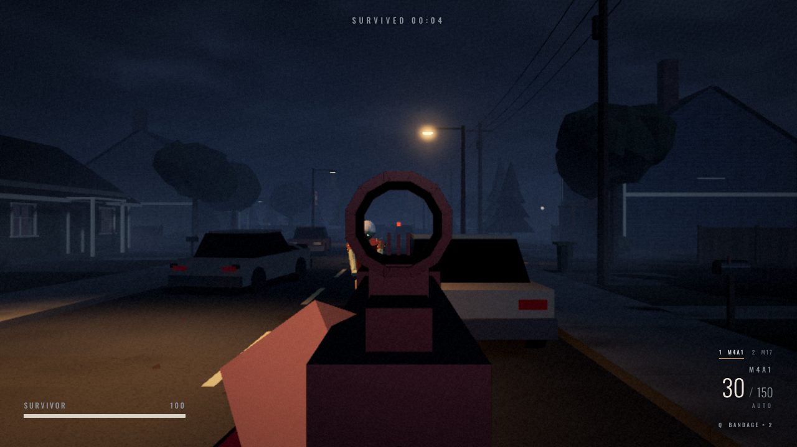 | 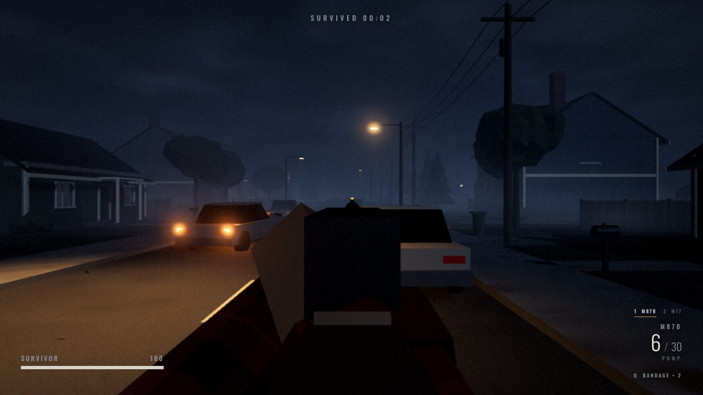 | 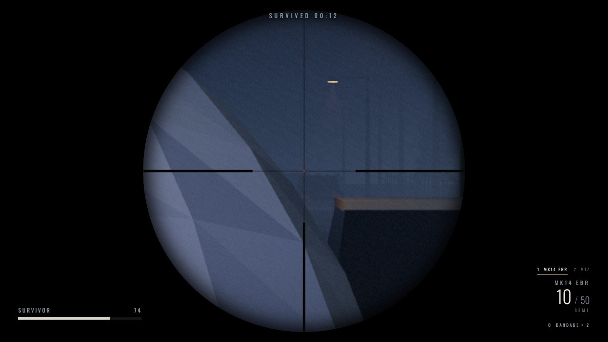 |
| M4A1 red dot | M870 bead | MK14 scope |

## Make your survivor

| | |
| --- | --- |
| 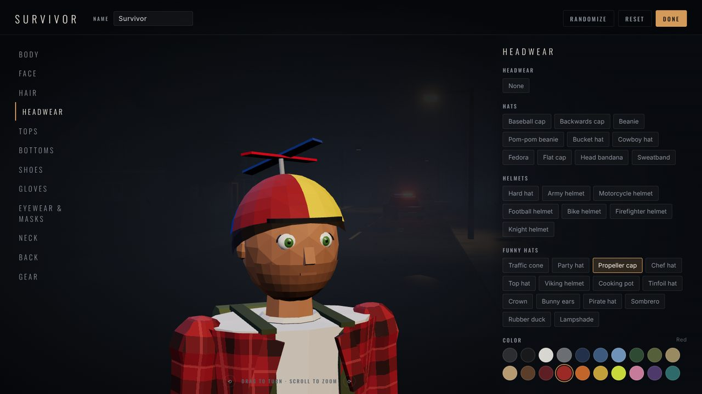 | 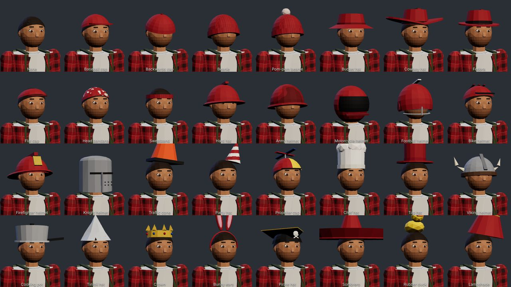 |
| The character creator, twelve tabs on a turntable | 31 hats, helmets and funny hats |
| 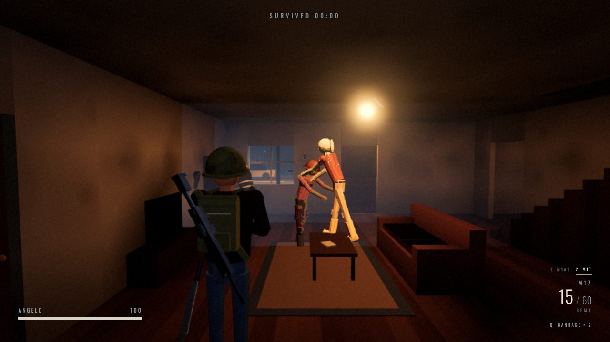 | 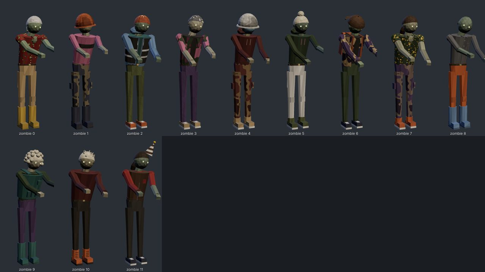 |
| Your survivor in the night | Zombies wear the same clothes, muddied |

## Play together

| | |
| --- | --- |
| 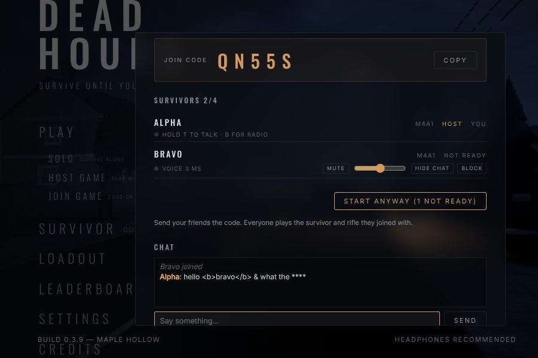 | 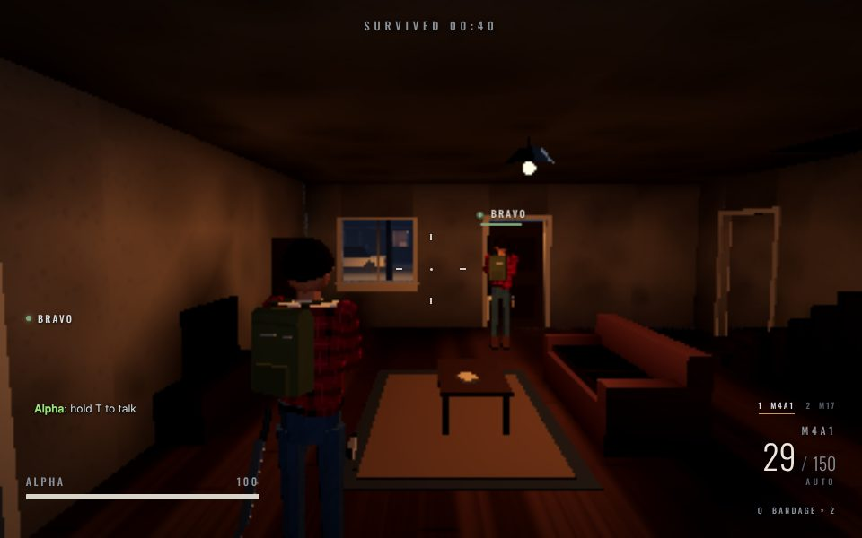 |
| Host a room and share the five-letter code | Proximity voice, team radio and text chat |

